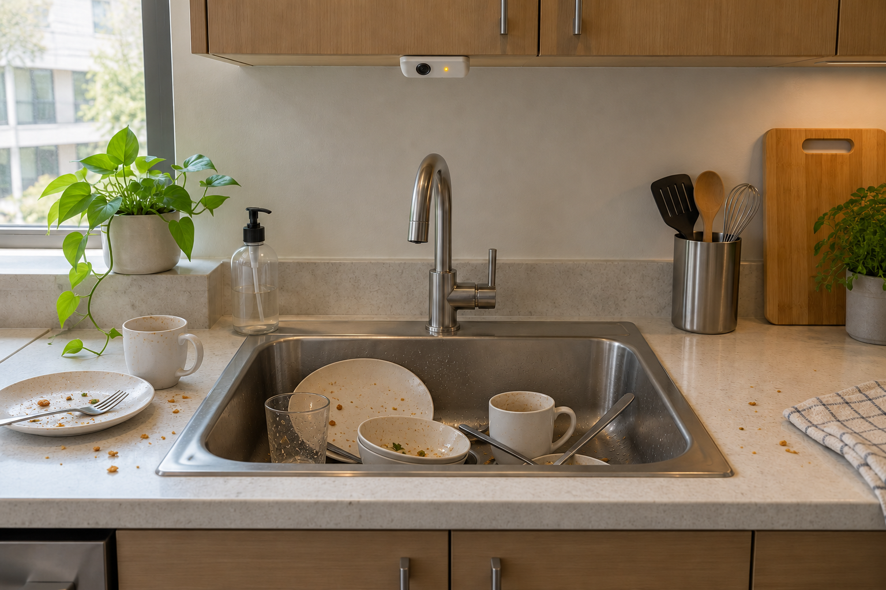
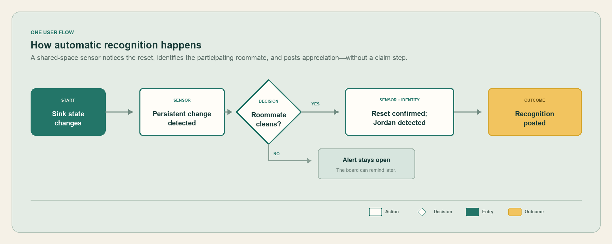

# Shared Space Recognition

An interactive product capstone exploring how roommates might coordinate shared-space cleanup while making everyday household effort feel noticed.

[View the live prototype](https://shared-space-recognition-demo.harrison-holcomb.chatgpt.site/#demo)



## The problem

Shared chores often create tension because the work is uneven, requests feel confrontational, and the person who quietly picks up the slack may receive little recognition. I began this project from my own experience living with roommates and wanted to explore a system that supports coordination without turning the home into a scoreboard.

## The concept

The prototype combines:

- A conceptual sensor that estimates the cleanliness of a specific shared area
- A Home Board that shows neutral, space-focused alerts
- Automatic appreciation when a participating roommate completes a cleanup
- Lightweight manual requests for tasks sensors cannot detect
- A weekly Thanks archive that keeps recognition visible without creating permanent scores



## Research and product thinking

I conducted four interviews with current or recent roommates. This small formative sample did not validate the product, but it helped identify useful directions and risks:

- People wanted household effort to be acknowledged.
- Cleaning requests could create confrontation or passive aggression.
- Privacy and incorrect attribution were major concerns.
- Many tasks, such as dusting or taking out trash, would not be captured reliably by a cleanliness sensor.

These observations informed neutral alert language, anonymous manual requests, correction-focused research questions, temporary recognition, and the decision to avoid points or rankings.

## Prototype features

- 20%, 50%, and 80% sink states with green, amber, and red feedback
- An alert only when the sink reaches the 80% attention threshold
- A synchronized Spaces view with live-monitoring indicators
- Automatic cleanup recognition in the demo flow
- Manual household requests with three urgency levels
- Identified or anonymous posting and completion
- One reaction per viewer on each recognition message
- Newest-first activity ordering and relative timestamps
- Board recognition for 24 hours, followed by a seven-day Thanks archive
- Browser-local persistence for the single-device prototype

## Feasibility boundary

The interface is a concept prototype, not evidence that a camera or identity system can accurately determine messiness or identify a cleaner. A real implementation would require opt-in participation, visible sensing boundaries, strong data minimization, attribution correction, and testing of whether automatic recognition feels supportive rather than invasive.

## Repository contents

- `prototype/` contains the complete static HTML, CSS, JavaScript, images, and user-flow assets.
- `docs/Roommate_Shared_Space_Status_PRD.docx` contains the product requirements document.
- `docs/Prototype_Review_Research_Kit.docx` contains the moderated research guide, questionnaire, observation sheets, and synthesis tools.
- `docs/Shared_Space_Recognition_User_Flow.png` is a presentation-ready user-flow image.

Raw interview files and internal QA exports are intentionally excluded to protect participant privacy and keep this portfolio repository focused.

## Run locally

From the repository root:

```bash
python3 -m http.server 8000 --directory prototype
```

Then open `http://localhost:8000`.

## Project status

This is an evolving capstone and formative research project. The next step is to run moderated usability and desirability sessions with current or recent roommates, synthesize patterns, and iterate on privacy, attribution, and conflict risks.
